# Awesome Multi-User Process Orchestration 🚀

  

  
  
  
  
  

## 🌐 Top Multi-User Process Orchestration Tools Ecosystem

> **A curated directory of enterprise SaaS solutions and open-source distributed workflow engines.**  
> *Engineered for Human-in-the-Loop Workflows, BPMN 2.0 State Modeling, Durable Execution, and Cross-Functional Process Automation.*  
> 📅 **Updated: 2026 Edition**

This repository tracks standout **SaaS platforms** and **open-source frameworks** in the **Multi-User Process Orchestration** ecosystem. Modern business architectures require workflow systems capable of coordinating interactions across distributed teams, external stakeholders, microservices, and autonomous AI agents. These engines excel at task routing, human approval gates, state persistence, SLA tracking, and distributed consensus.

---

## 📑 Table of Contents

- [📊 Sector Overview & Market Dynamics](#-sector-overview--market-dynamics)
- [☁️ SaaS & Hosted Platforms](#️-saas--hosted-platforms)
- [🔓 Open-Source GitHub Projects](#-open-source-github-projects)
- [🧩 Architecture & Stack Composition](#-architecture--stack-composition)
- [🤝 How to Contribute](#-how-to-contribute)
- [📈 Star History](#-star-history)
- [💖 Support & Community](#-support--community)
- [⚖️ Disclaimer](#️-disclaimer)

---

## 📊 Sector Overview & Market Dynamics

The global business process and workflow orchestration sector is currently estimated at **$7.2B–$11.3B** (surpassing **$20B+** when factoring in the broader IT infrastructure automation and data orchestration categories), advancing at a compound annual growth rate (CAGR) of 15%–22%. Growth is accelerated by enterprise AI orchestration, agentic human-in-the-loop governance, and legacy system modernization.

The market displays **moderate fragmentation with multi-polar concentration**:
- **Enterprise Mega-Cap Incumbents** (*Salesforce, SAP*) anchor CRM- and ERP-adjacent workflows.
- **Durable Execution & Distributed Orchestration Leaders** (*Temporal, Camunda*) power code-first microservice flows and high-throughput resilient state machines.
- **Low-Code & Citizen Automation Specialists** (*Appian, Nintex, Kissflow*) capture operational line-of-business deployments.
- **AI-Native & Open Automation Hubs** (*Dify, n8n, Activepieces, Windmill*) bridge rapid visual builder ecosystems with autonomous multi-agent orchestration.

Rather than consolidating into a single winner-take-all environment, the sector rewards interoperability, hybrid event brokers, and developer flexibility.

---

## ☁️ SaaS & Hosted Platforms

The following hosted solutions provide turnkey infrastructure, security compliances (SOC 2, HIPAA, ISO 27001), managed high availability, and out-of-the-box user governance. Platforms are sorted in descending order by **Company Valuation / Revenue Scale**.

| 🏢 Platform | 💰 Company Size / Valuation | 🏷️ Starting Pricing Tier | 🎁 Free Tier / Trial Limit | 📝 Key Capabilities |
| :--- | :--- | :--- | :--- | :--- |
| **[Salesforce Flow Orchestrator](https://www.salesforce.com/)** | **~$270B–$280B** Market Cap (~$38B Rev) | Included in Salesforce CRM tiers (from **$25/user/month** on Starter/Pro Suite; standard Flow Orchestration bundled at $0 add-on) | **30-day free trial** of Salesforce CRM (full standard Flow Orchestrator features included) | Multi-step, multi-user workflow engine within Salesforce for coordinating approvals, tasks, and stages across departments. |
| **[Signavio (SAP)](https://www.signavio.com/)** | **~$250B–$270B** Market Cap (SAP parent; **$1.2B** acquisition valuation) | Modeler licenses estimated from **€50–€150/user/month** (Enterprise base packages typically start from ~**€30,000/year**) | **30-day free trial** of SAP Signavio Process Transformation Suite (Process Manager & Collaboration Hub access) | Business process management suite with process modeling, mining, and workflow orchestration capabilities. |
| **[Temporal Cloud](https://temporal.io/)** | **$12.55B** Valuation (Series E; $250M+ ARR) | Essentials plan starts at **$100/month** (bundled actions & storage; consumption pay-as-you-go thereafter) | **$1,000 in free cloud credits** upon sign-up (or $2,400 via startup program); forever-free open-source engine for self-hosting | Managed durable execution platform for orchestrating long-running, multi-step workflows across services and teams. |
| **[Appian Orchestration](https://appian.com/)** | **$2.87B** Market Cap ($726M+ Rev) | Standard tier starts from **$70–$100/user/month** (entry-level annual contracts commonly have a 100-user minimum commitment) | **Community Edition: Free forever** (dedicated personal development/learning cloud workspace; strictly non-production) | Enterprise low-code automation platform with process modeling, case management, and AI-driven orchestration. |
| **[Nintex Workflow Cloud](https://www.nintex.com/)** | **~$2.0B+** Valuation (TPG Capital buyout) | Pro packages start at **~$1,250/month** (billed annually at ~$15,000/year for core workflow instance allotments) | **30-day free trial** (unlimited workflow & form building for evaluation, no credit card required) | Process automation platform with drag-and-drop workflow design, forms, and multi-user task assignment. |
| **[PagerDuty (Catalytic)](https://www.pagerduty.com/)** | **$1.26B** Market Cap ($485M+ Rev; acquired Catalytic) | Professional plan starts at **$21/user/month** (Business tier with advanced orchestration at **$41/user/month**) | **Free forever plan** for up to 5 users (basic incident alerting); **14-day free trial** for premium orchestration workflows | Intelligent process automation and incident workflow platform combining orchestration with AI-assisted routing. |
| **[Camunda Cloud (Camunda 8)](https://camunda.com/)** | **~$1.0B+** Valuation (~$200M ARR) | Professional SaaS plan starts at **$49/month** (base cluster execution + usage) | **Free Starter plan forever** (up to 5 users & 5 clusters for modeling and non-production POCs); **30-day trial** for full execution | Managed workflow and decision automation platform based on Zeebe, supporting BPMN, DMN, and human task orchestration. |
| **[Kissflow](https://kissflow.com/)** | **~$400M** Valuation (~$90M Rev) | Basic tier starts at **$1,500/month** (flat platform rate including user & transaction usage bundle) | **No self-serve free trial**; 14-day custom sales-assisted sandbox POC upon demo qualification | No-code workflow and process automation platform with approvals, forms, and cross-departmental orchestration. |
| **[Tonkean](https://tonkean.com/)** | **~$300M+** Valuation (Acquired by Coupa in 2026; $83M funding) | Standard enterprise deployment packages start from **~$10,000/month** (based on Monthly Tracked Users and system integrations) | **No public free tier**; qualified enterprise pilot/trial available via sales evaluation | No-code process orchestration platform that coordinates people, systems, and data across business operations. |
| **[ProcessMaker](https://www.processmaker.com/)** | **~$150M–$200M** Valuation (Acquired by Decisions; $22M–$64M Rev) | Standard plan starts at **~$1,495–$3,000/month** (case-based volume licensing with unlimited users) | **7-day to 14-day free trial** upon demo request; open-source Community Edition available for self-hosting | Low-code BPM and workflow automation platform with visual process designer, forms, and multi-user task routing. |

---

## 🔓 Open-Source GitHub Projects

Curated self-hosted workflow engines, BPMN modeling suites, and distributed orchestrators. Sorted strictly in **descending order by GitHub Stars_Count**. Each badge is styled with `style=social&color=white` and links directly to that repository's stargazers.

- **[n8n](https://github.com/n8n-io/n8n)**   
  Fair-code workflow automation platform with an intuitive visual node designer, human approval triggers, multi-user collaboration workspaces, and 400+ native app integrations.

- **[Dify](https://github.com/langgenius/dify)**   
  Leading open-source LLM app development and agentic workflow orchestration platform with visual orchestration, multi-user workspaces, and human-in-the-loop review nodes.

- **[Apache Airflow](https://github.com/apache/airflow)**   
  Battle-tested workflow automation platform authored in Python, featuring DAG-based pipelines, human approval and review sensors, role-based access control, and rich cluster scheduling.

- **[Kestra](https://github.com/kestra-io/kestra)**   
  Universal declarative event-driven orchestration engine using YAML workflows, built-in human verification steps, multi-tenant RBAC, and 500+ ecosystem plugins.

- **[Activepieces](https://github.com/activepieces/activepieces)**   
  Open-source no-code business automation platform built as an alternative to Zapier, supporting multi-user workspace management, custom TypeScript piece authoring, and approval loops.

- **[Prefect](https://github.com/PrefectHQ/prefect)**   
  Python-native resilient workflow orchestration engine with native human-in-the-loop pausing/resuming primitives, concurrency controls, and multi-team workspace administration.

- **[Node-RED](https://github.com/node-red/node-red)**   
  Low-code visual event-driven flow programming environment for connecting IoT devices, APIs, multi-user administrative dashboards, and asynchronous approval pipelines.

- **[Temporal](https://github.com/temporalio/temporal)**   
  Industry standard for durable code-as-workflows execution. Guarantees workflow state recovery across outages, supporting multi-party human signal/query mechanisms and cross-service coordination.

- **[Windmill](https://github.com/windmill-labs/windmill)**   
  Extremely fast, developer-first orchestration framework turning Python, TypeScript, and Go scripts into multi-step workflows, internal UIs, and multi-user approval flows.

- **[Argo Workflows](https://github.com/argoproj/argo-workflows)**   
  Cloud-native container-based workflow engine for Kubernetes, featuring DAG step orchestration, suspend/resume manual confirmation gates, and multi-tenant namespace isolation.

- **[Trigger.dev](https://github.com/triggerdotdev/trigger.dev)**   
  Open-source durable developer framework for long-running TypeScript background tasks, human approval steps, real-time logging, and serverless execution.

- **[Netflix Conductor](https://github.com/netflix/conductor)**   
  Distributed orchestration engine developed at Netflix for coordinating microservices, human tasks, decision branches, and enterprise multi-system process state.

- **[Activiti](https://github.com/Activiti/Activiti)**   
  Lightweight Java/Spring-centric open-source BPMN 2.0 workflow and decision management engine designed for embeddable multi-user task execution and process automation.

- **[Flowable](https://github.com/flowable/flowable-engine)**   
  Enterprise-grade BPMN, CMMN, and DMN execution suite supporting complex case management, dynamic human-in-the-loop task routing, and granular multi-user permissions.

- **[Elsa Workflows](https://github.com/elsa-workflows/elsa-core)**   
  Open-source .NET workflows library and visual designer enabling developers to embed multi-user approval workflows and durable execution within ASP.NET Core applications.

- **[Flyte](https://github.com/flyteorg/flyte)**   
  Structured, scalable Kubernetes-native workflow orchestration platform for machine learning, data engineering, and multi-team reproducible pipeline orchestration.

- **[StackStorm](https://github.com/StackStorm/st2)**   
  Event-driven DevOps and SecOps runbook automation platform with rules engines, multi-user role assignments, and extensible integration packs.

- **[Apache Camel](https://github.com/apache/camel)**   
  Versatile open-source enterprise integration patterns (EIP) framework, facilitating routing, data mediation, and multi-system business transaction flows.

- **[Rundeck](https://github.com/rundeck/rundeck)**   
  Runbook automation console providing self-service operations, human authorization barriers, granular access controls, and multi-team infrastructure orchestration.

- **[Apache NiFi](https://github.com/apache/nifi)**   
  Visual real-time data ingestion and processing framework supporting interactive multi-tenant flow design, data provenance tracking, and routing policies.

- **[Inngest](https://github.com/inngest/inngest)**   
  Event-driven durable execution engine for building complex workflows, user-directed approval pauses, and step functions without managing dedicated queue infrastructure.

- **[Workflow Core](https://github.com/danielgerlag/workflow-core)**   
  Lightweight .NET core workflow library supporting sequential, parallel, and multi-user human approval task definitions with persistent state.

- **[Zeebe](https://github.com/camunda/zeebe)**   
  High-throughput distributed workflow engine powering Camunda 8, built for cloud-native scale, BPMN orchestration, and partitioned event streaming.

- **[Camunda Platform 7](https://github.com/camunda/camunda-bpm-platform)**   
  The classic open-source BPMN 2.0 workflow and decision automation engine used globally for enterprise human task management, forms, and Java integration.

- **[Viewflow](https://github.com/viewflow/viewflow)**   
  Reusable workflow framework for Django and Python developers providing BPMN-modeled multi-user business processes and administrative UI components.

- **[Corteza](https://github.com/cortezaproject/corteza)**   
  Self-hosted low-code alternative to Salesforce, including visual workflow builders, multi-user CRM components, and enterprise record management.

- **[SpiffWorkflow](https://github.com/sartography/SpiffWorkflow)**   
  Pure Python BPMN/DMN workflow runtime with full support for multi-user tasks, DMN decision tables, and visual frontend web designers.

- **[jBPM](https://github.com/kiegroup/jbpm)**   
  Comprehensive open-source Business Process Management (BPM) suite offering visual BPMN 2.0 modeling, human task lists, and business rules integration.

- **[Joget DX](https://github.com/jogetworkflow/jw-community)**   
  Open-source low-code development platform combining drag-and-drop process management, form designers, and multi-user portal management.

- **[Benthos / Redpanda Connect](https://github.com/redpanda-data/benthos)**   
  High-performance stream processor and data orchestrator with declarative YAML pipelines for connecting disparate data systems and event pipelines.

- **[ProcessMaker Community](https://github.com/processmaker/processmaker)**   
  The community edition of ProcessMaker, delivering open-source BPM modeling, multi-user case tracking, and form-driven routing.

- **[Imixs-Workflow](https://github.com/imixs/imixs-workflow)**   
  Open-source Java EE/Jakarta EE workflow engine focused on human-centric business processes, security, and document-level audit compliance.

- **[Bonita Engine](https://github.com/bonitasoft/bonita-engine)**   
  Extensible open-source business process automation engine with visual UI designers, human tasks, and enterprise service connectors.

---

## 🧩 Architecture & Stack Composition

When constructing an enterprise-grade self-hosted process orchestration architecture, engineering teams commonly integrate:
- **Core Orchestrator**: [Temporal](https://github.com/temporalio/temporal) for resilient durable microservices or [Flowable](https://github.com/flowable/flowable-engine) / [Camunda](https://github.com/camunda/zeebe) for strict BPMN compliance.
- **Visual & AI Coordination**: [Dify](https://github.com/langgenius/dify) or [n8n](https://github.com/n8n-io/n8n) for rapid no-code prototyping and AI agent task delegation.
- **Identity & Access Management**: Keycloak or Authentik for OpenID Connect, OAuth2, and role-based human approval permission trees.
- **Event Mesh & Ingestion**: Apache Kafka, RabbitMQ, or NATS for reliable cross-system message buffering.
- **Observability**: Prometheus, OpenTelemetry, and Grafana for latency auditing and SLA monitoring.

---

## 🤝 How to Contribute

Contributions are welcome! To suggest additions or improvements:

1. 🍴 **Fork the repo.**
2. 🌿 **Create your branch**: `git checkout -b feature/add-new-orchestrator`
3. ✍️ **Add entries**: Follow the existing format (include accurate starting pricing, free tier specifications, and licensing).
4. 🚀 **Submit a Pull Request** with a concise description of the tool.

---

## 📈 Star History

---

## 💖 Support & Community

If you find this curated collection helpful for your projects, architecture planning, or workflow research:
- ⭐ **Star this repository** to stay informed on updates.
- 🍴 **Fork and share** with colleagues and engineering teams.
- ☕ **Support the maintainer**: Buy a coffee and support ongoing open-source research via the [GitHub Sponsors Dashboard](https://github.com/sponsors/ishandutta2007).

---

## ⚖️ Disclaimer

- This repository is a community-curated research catalog and does not constitute commercial endorsement or financial advice.
- When orchestrating workflows across multi-user environments, always audit privacy regulations (GDPR, CCPA, HIPAA) and ensure robust security hardening for self-hosted instances.

---

  <b>Crafted with ❤️ for software architects, operations engineers, and developers building scalable workflow systems.</b>

